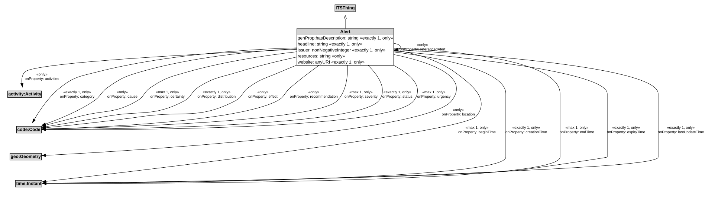

# Alert

An Alert can be used to notify people of important information.

## Restrictions

| Property | Restriction Type |
|----------|------------------|
| activities | All values from activity:Activity |
| beginTime | All values from time1:Instant |
| beginTime | Max cardinality 1 time1:Instant |
| category | All values from code:Code |
| category | Exact cardinality 1 code:Code |
| cause | All values from code:Code |
| certainty | All values from code:Code |
| certainty | Max cardinality 1 code:Code |
| creationTime | All values from time1:Instant |
| creationTime | Exact cardinality 1 time1:Instant |
| distribution | All values from code:Code |
| distribution | Exact cardinality 1 code:Code |
| effect | All values from code:Code |
| endTime | All values from time1:Instant |
| endTime | Max cardinality 1 time1:Instant |
| expiryTime | All values from time1:Instant |
| hasDescription | All values from xsd:string |
| hasDescription | Exact cardinality 1 xsd:string |
| headline | All values from xsd:string |
| headline | Exact cardinality 1 xsd:string |
| issuer | All values from xsd:nonNegativeInteger |
| issuer | Exact cardinality 1 xsd:nonNegativeInteger |
| lastUpdateTime | All values from time1:Instant |
| lastUpdateTime | Exact cardinality 1 time1:Instant |
| location | All values from geo1:Geometry |
| recommendation | All values from code:Code |
| referencedAlert | All values from [Alert](Alert.md) |
| resources | All values from xsd:anyURI |
| severity | All values from code:Code |
| severity | Max cardinality 1 code:Code |
| status | All values from code:Code |
| status | Exact cardinality 1 code:Code |
| urgency | All values from code:Code |
| urgency | Max cardinality 1 code:Code |
| website | All values from xsd:anyURI |

## Pattern

This class is a part of the [TransportAlertPattern](../TransportAlertPattern.md) pattern.
