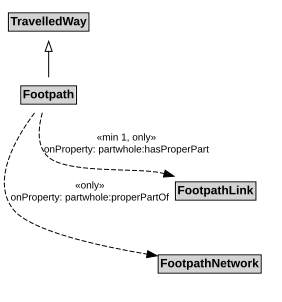

# Footpath

A Footpath is a type of TravelledWay that is made up of FootpathLinks.

## Restrictions

| Property | Restriction Type |
|----------|------------------|
| hasProperPart | All values from [FootpathLink](FootpathLink.md) |
| hasProperPart | Min cardinality 1 [FootpathLink](FootpathLink.md) |
| properPartOf | All values from [FootpathNetwork](FootpathNetwork.md) |

## Pattern

This class is a part of the [PedestrianNetworkPattern](../PedestrianNetworkPattern.md) pattern.
