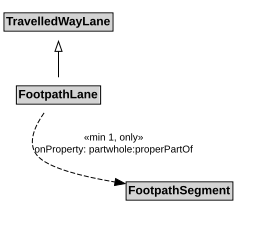

# FootpathLane

A FootpathLane is a type of TravelledWayLane that forms part of a FootpathSegment.

## Restrictions

| Property | Restriction Type |
|----------|------------------|
| properPartOf | All values from [FootpathSegment](FootpathSegment.md) |
| properPartOf | Min cardinality 1 [FootpathSegment](FootpathSegment.md) |

## Pattern

This class is a part of the [PedestrianNetworkPattern](PedestrianNetworkPattern.md) pattern.
