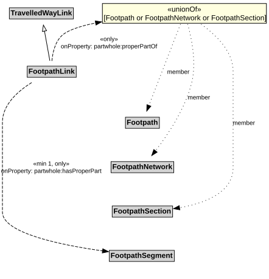

# FootpathLink

A Footpath Link is a type of TravelledWayLink designed for pedestrians.

## Restrictions

| Property | Restriction Type |
|----------|------------------|
| hasProperPart | All values from [FootpathSegment](FootpathSegment.md) |
| hasProperPart | Min cardinality 1 [FootpathSegment](FootpathSegment.md) |
| properPartOf | All values from [Footpath](Footpath.md) or [FootpathNetwork](FootpathNetwork.md) or [FootpathSection](FootpathSection.md) |

## Pattern

This class is a part of the [PedestrianNetworkPattern](PedestrianNetworkPattern.md) pattern.
