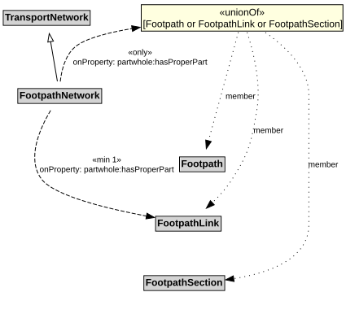

# FootpathNetwork

A FootpathNetwork is a type of TransportNetwork designed for the use of pedestrians but may be used by others as well.

## Restrictions

| Property | Restriction Type |
|----------|------------------|
| hasProperPart | All values from [Footpath](Footpath.md) or [FootpathLink](FootpathLink.md) or [FootpathSection](FootpathSection.md) |
| hasProperPart | Min cardinality 1 [FootpathLink](FootpathLink.md) |

## Pattern

This class is a part of the [PedestrianNetworkPattern](../PedestrianNetworkPattern.md) pattern.
