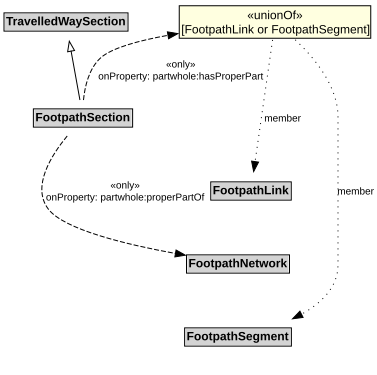

# FootpathSection

A FootpathSection is a type of TravelledWaySection that groups FootpathLinks and FootpathSegments for a useful operational purpose.

## Restrictions

| Property | Restriction Type |
|----------|------------------|
| hasProperPart | All values from [FootpathLink](FootpathLink.md) or [FootpathSegment](FootpathSegment.md) |
| properPartOf | All values from [FootpathNetwork](FootpathNetwork.md) |

## Pattern

This class is a part of the [PedestrianNetworkPattern](../PedestrianNetworkPattern.md) pattern.
