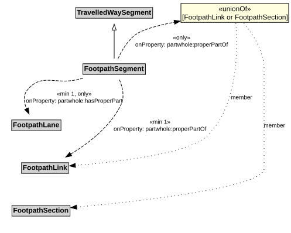

# FootpathSegment

A FootpathSegment is a type of TravelledWaySegment that represents a portion of a FootpathLink with common physical characteristics.

NOTE: A FootpathSegment can be defined to be a part of a FootpathSection, especially when the FootpathSection does not span an entire FootpathLink.

## Restrictions

| Property | Restriction Type |
|----------|------------------|
| hasProperPart | All values from [FootpathLane](FootpathLane.md) |
| hasProperPart | Min cardinality 1 [FootpathLane](FootpathLane.md) |
| properPartOf | All values from [FootpathLink](FootpathLink.md) or [FootpathSection](FootpathSection.md) |
| properPartOf | Min cardinality 1 [FootpathLink](FootpathLink.md) |

## Pattern

This class is a part of the [PedestrianNetworkPattern](../PedestrianNetworkPattern.md) pattern.
