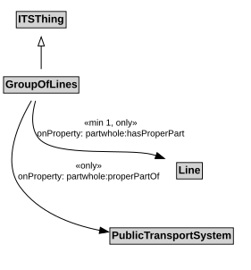

# GroupOfLines

A GroupOfLines is a logical grouping of PublicTransportLines for any useful purpose.

## Restrictions

| Property | Restriction Type |
|----------|------------------|
| hasProperPart | All values from [PublicTransportLine](PublicTransportLine.md) |
| hasProperPart | Min cardinality 1 [PublicTransportLine](PublicTransportLine.md) |
| properPartOf | All values from [PublicTransportSystem](PublicTransportSystem.md) |

## Pattern

This class is a part of the [PublicTransportSystemPattern](PublicTransportSystemPattern.md) pattern.
