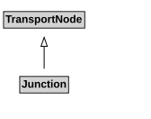

# Junction

A Junction is a TransportNode that allows a traveller to connect from one TravelledWayLink to another.

## Pattern

This class is a part of the [TransportNetworkPattern](../TransportNetworkPattern.md) pattern.
