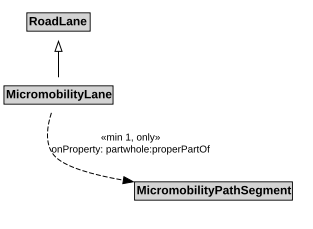

# MicromobilityLane

A MicromobilityLane is a type of RoadLane that forms part of a MicromobilityPathSegment.

## Restrictions

| Property | Restriction Type |
|----------|------------------|
| properPartOf | All values from [MicromobilityPathSegment](MicromobilityPathSegment.md) |
| properPartOf | Min cardinality 1 [MicromobilityPathSegment](MicromobilityPathSegment.md) |

## Pattern

This class is a part of the [MicromobilityNetworkPattern](MicromobilityNetworkPattern.md) pattern.
