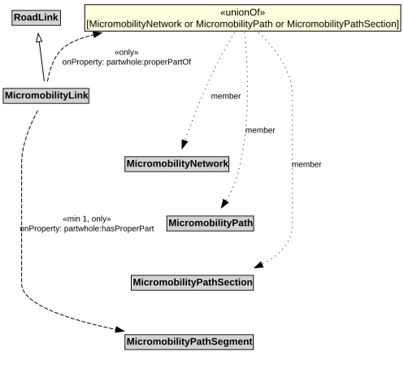

# MicromobilityLink

A MicromobilityLink is a type of RoadLink designed for micromobility vehicles.

## Restrictions

| Property | Restriction Type |
|----------|------------------|
| hasProperPart | All values from [MicromobilityPathSegment](MicromobilityPathSegment.md) |
| hasProperPart | Min cardinality 1 [MicromobilityPathSegment](MicromobilityPathSegment.md) |
| properPartOf | All values from [MicromobilityNetwork](MicromobilityNetwork.md) or [MicromobilityPath](MicromobilityPath.md) or [MicromobilityPathSection](MicromobilityPathSection.md) |

## Pattern

This class is a part of the [MicromobilityNetworkPattern](MicromobilityNetworkPattern.md) pattern.
