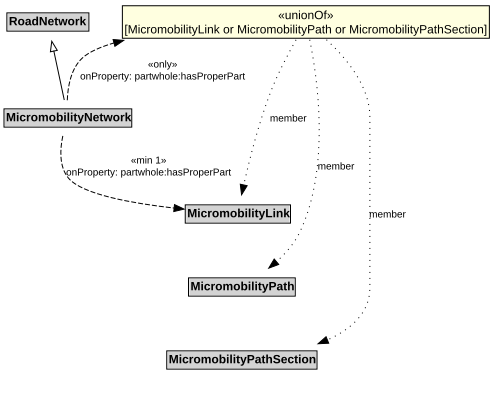

# MicromobilityNetwork

A MicromobilityNetwork is a type of RoadNetwork designed for the use of micromobility vehicles, which have more limited performance characteristics than motor vehicles.

## Restrictions

| Property | Restriction Type |
|----------|------------------|
| hasProperPart | All values from [MicromobilityLink](MicromobilityLink.md) or [MicromobilityPath](MicromobilityPath.md) or [MicromobilityPathSection](MicromobilityPathSection.md) |
| hasProperPart | Min cardinality 1 [MicromobilityLink](MicromobilityLink.md) |

## Pattern

This class is a part of the [MicromobilityNetworkPattern](MicromobilityNetworkPattern.md) pattern.
