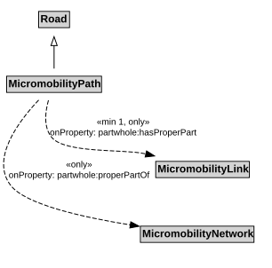

# MicromobilityPath

A MicromobilityPath is a type of Road that is made up of MicromobilityPathLinks.

## Restrictions

| Property | Restriction Type |
|----------|------------------|
| hasProperPart | All values from [MicromobilityLink](MicromobilityLink.md) |
| hasProperPart | Min cardinality 1 [MicromobilityLink](MicromobilityLink.md) |
| properPartOf | All values from [MicromobilityNetwork](MicromobilityNetwork.md) |

## Pattern

This class is a part of the [MicromobilityNetworkPattern](MicromobilityNetworkPattern.md) pattern.
