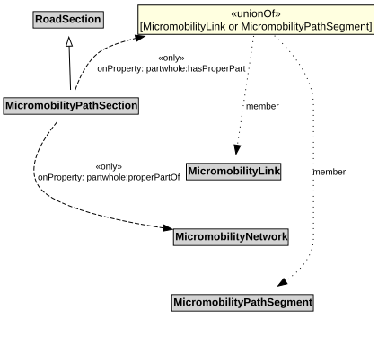

# MicromobilityPathSection

A MicromobilityPathSections is a type of RoadSection that groups MicromobilityLinks and MicromobilityPathSegments for a useful operational purpose (e.g., assigning a speed limit, designating areas of shared use).

## Restrictions

| Property | Restriction Type |
|----------|------------------|
| hasProperPart | All values from [MicromobilityLink](MicromobilityLink.md) or [MicromobilityPathSegment](MicromobilityPathSegment.md) |
| properPartOf | All values from [MicromobilityNetwork](MicromobilityNetwork.md) |

## Pattern

This class is a part of the [MicromobilityNetworkPattern](MicromobilityNetworkPattern.md) pattern.
