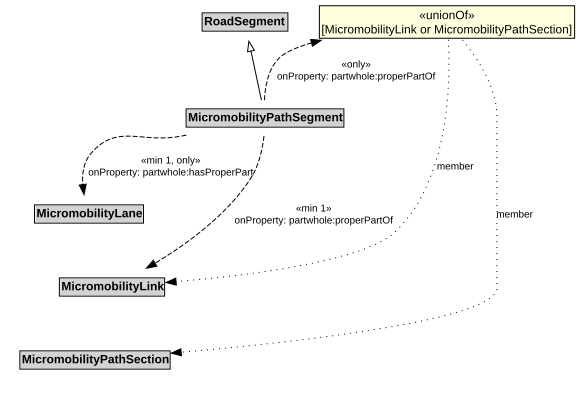

# MicromobilityPathSegment

A MicromobilityPathSegment is a type of RoadSegment that represents a portion of a MicromobilityLink with common physical characteristics.

NOTE: A MicromobilityPathSegment can be defined to be a part of a MicromobilityPathSection, especially when the MicromobilityPathSection does not span an entire MicromobilityLink.

## Restrictions

| Property | Restriction Type |
|----------|------------------|
| hasProperPart | All values from [MicromobilityLane](MicromobilityLane.md) |
| hasProperPart | Min cardinality 1 [MicromobilityLane](MicromobilityLane.md) |
| properPartOf | All values from [MicromobilityLink](MicromobilityLink.md) or [MicromobilityPathSection](MicromobilityPathSection.md) |
| properPartOf | Min cardinality 1 [MicromobilityLink](MicromobilityLink.md) |

## Pattern

This class is a part of the [MicromobilityNetworkPattern](MicromobilityNetworkPattern.md) pattern.
