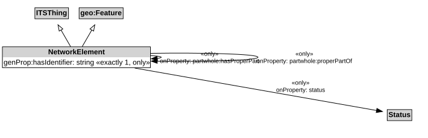

# NetworkElement

A NetworkElement represents any element of a transport network. It can be a part of another NetworkElement and can be decomposed into smaller NetworkElements.

## Other Annotations

- abstract: True

## Restrictions

| Property | Restriction Type |
|----------|------------------|
| hasIdentifier | All values from xsd:string |
| hasIdentifier | Exact cardinality 1 xsd:string |
| hasProperPart | All values from [NetworkElement](NetworkElement.md) |
| properPartOf | All values from [NetworkElement](NetworkElement.md) |
| status | All values from [Status](Status.md) |

## Pattern

This class is a part of the [TransportNetworkPattern](../TransportNetworkPattern.md) pattern.
