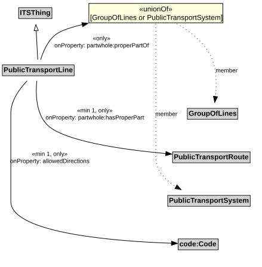

# PublicTransportLine

A PublicTransportLine is one or more routes used by public transport vehicles to transport passengers to and from designated locations.

## Restrictions

| Property | Restriction Type |
|----------|------------------|
| allowedDirections | All values from code:Code |
| allowedDirections | Min cardinality 1 code:Code |
| hasProperPart | All values from [PublicTransportRoute](PublicTransportRoute.md) |
| hasProperPart | Min cardinality 1 [PublicTransportRoute](PublicTransportRoute.md) |
| properPartOf | All values from [GroupOfLines](GroupOfLines.md) or [PublicTransportSystem](PublicTransportSystem.md) |

## Pattern

This class is a part of the [PublicTransportSystemPattern](../PublicTransportSystemPattern.md) pattern.
