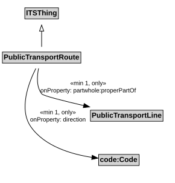

# PublicTransportRoute

A PublicTransportRoute represents one specific path used by a public transport vehicle to transport passengers to and from designated locations.

NOTE: For example, a PublicTransportLine might use an alternate PublicTransportRoute to reach its next stop during periods of congestion.

## Restrictions

| Property | Restriction Type |
|----------|------------------|
| direction | All values from code:Code |
| direction | Min cardinality 1 code:Code |
| properPartOf | All values from [PublicTransportLine](PublicTransportLine.md) |
| properPartOf | Min cardinality 1 [PublicTransportLine](PublicTransportLine.md) |

## Pattern

This class is a part of the [PublicTransportSystemPattern](PublicTransportSystemPattern.md) pattern.
