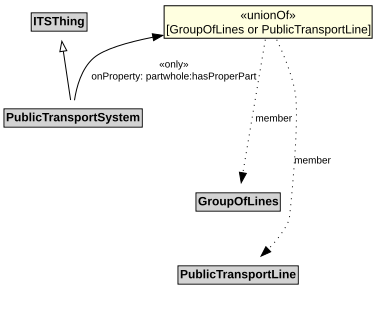

# PublicTransportSystem

A PublicTransportSystem provides transport services to members of the public.

## Restrictions

| Property | Restriction Type |
|----------|------------------|
| hasProperPart | All values from [GroupOfLines](GroupOfLines.md) or [PublicTransportLine](PublicTransportLine.md) |

## Pattern

This class is a part of the [PublicTransportSystemPattern](../PublicTransportSystemPattern.md) pattern.
