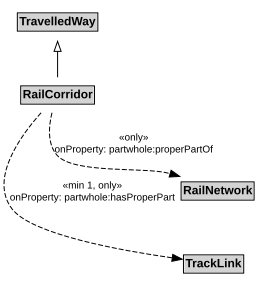

# RailCorridor

A RailCorridor is a type of TravelledWay that is made up of TrackLinks.

## Restrictions

| Property | Restriction Type |
|----------|------------------|
| hasProperPart | All values from [TrackLink](TrackLink.md) |
| hasProperPart | Min cardinality 1 [TrackLink](TrackLink.md) |
| properPartOf | All values from [RailNetwork](RailNetwork.md) |

## Pattern

This class is a part of the [RailNetworkPattern](../RailNetworkPattern.md) pattern.
