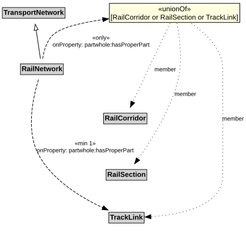

# RailNetwork

A RailNetwork is a type of TransportNetwork using rails on a stabilized base.

## Restrictions

| Property | Restriction Type |
|----------|------------------|
| hasProperPart | All values from [RailCorridor](RailCorridor.md) or [RailSection](RailSection.md) or [TrackLink](TrackLink.md) |
| hasProperPart | Min cardinality 1 [TrackLink](TrackLink.md) |

## Pattern

This class is a part of the [RailNetworkPattern](RailNetworkPattern.md) pattern.
