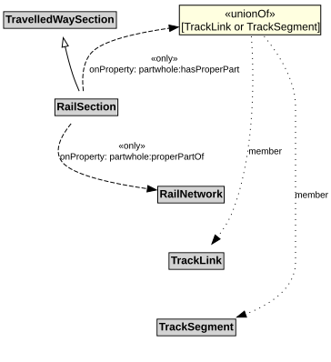

# RailSection

A RailSection is a type of TravelledWaySection that groups TrackLinks and TrackSegments for a useful operational purpose (e.g., assigning a speed limit, designating a traffic control scheme).

## Restrictions

| Property | Restriction Type |
|----------|------------------|
| hasProperPart | All values from [TrackLink](TrackLink.md) or [TrackSegment](TrackSegment.md) |
| properPartOf | All values from [RailNetwork](RailNetwork.md) |

## Pattern

This class is a part of the [RailNetworkPattern](../RailNetworkPattern.md) pattern.
