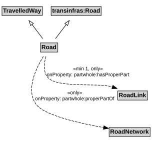

# Road

A Road is a type of TravelledWay and transinfras:Road that is made up of RoadLinks. Roads form a proper part of RoadNetworks.

## Restrictions

| Property | Restriction Type |
|----------|------------------|
| hasProperPart | All values from [RoadLink](RoadLink.md) |
| hasProperPart | Min cardinality 1 [RoadLink](RoadLink.md) |
| properPartOf | All values from [RoadNetwork](RoadNetwork.md) |

## Pattern

This class is a part of the [RoadNetworkPattern](RoadNetworkPattern.md) pattern.
