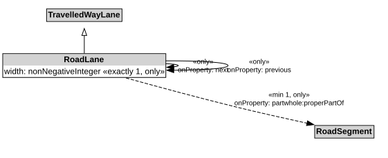

# RoadLane

A RoadLane is a type of TravelledWayLane that forms part of a RoadSegment.

## Restrictions

| Property | Restriction Type |
|----------|------------------|
| next | All values from [RoadLane](RoadLane.md) |
| previous | All values from [RoadLane](RoadLane.md) |
| properPartOf | All values from [RoadSegment](RoadSegment.md) |
| properPartOf | Min cardinality 1 [RoadSegment](RoadSegment.md) |
| width | All values from xsd:nonNegativeInteger |
| width | Exact cardinality 1 xsd:nonNegativeInteger |

## Pattern

This class is a part of the [RoadNetworkPattern](../RoadNetworkPattern.md) pattern.
