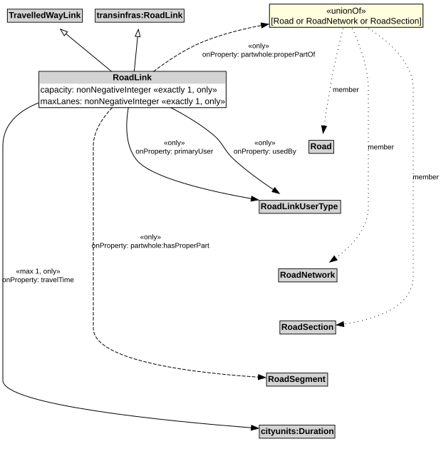

# RoadLink

A RoadLink is a type of TravelledWayLink and transinfras:RoadLink using a stabilized base designed for the movement of vehicles that conform to a specified set of requirements but may be used by others as well.

## Restrictions

| Property | Restriction Type |
|----------|------------------|
| capacity | All values from xsd:nonNegativeInteger |
| capacity | Exact cardinality 1 xsd:nonNegativeInteger |
| hasProperPart | All values from [RoadSegment](RoadSegment.md) |
| maxLanes | All values from xsd:nonNegativeInteger |
| maxLanes | Exact cardinality 1 xsd:nonNegativeInteger |
| primaryUser | All values from [RoadLinkUserType](RoadLinkUserType.md) |
| properPartOf | All values from [Road](Road.md) or [RoadNetwork](RoadNetwork.md) or [RoadSection](RoadSection.md) |
| travelTime | All values from cityunits:Duration |
| travelTime | Max cardinality 1 cityunits:Duration |
| usedBy | All values from [RoadLinkUserType](RoadLinkUserType.md) |

## Pattern

This class is a part of the [RoadNetworkPattern](RoadNetworkPattern.md) pattern.
