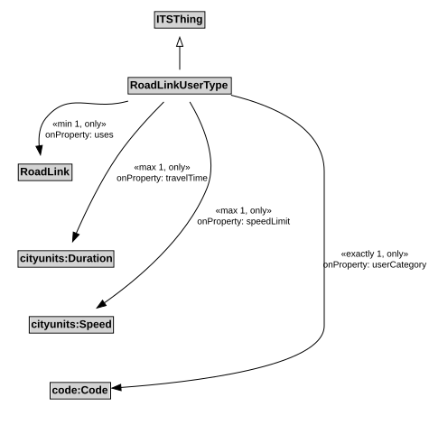

# RoadLinkUserType

A RoadLinkUserType represents the unique combination of a RoadLink and a UserType such that speed limits and other characteristics can be defined to apply to specific user types when operating along a particular road link.

## Restrictions

| Property | Restriction Type |
|----------|------------------|
| speedLimit | All values from cityunits:Speed |
| speedLimit | Max cardinality 1 cityunits:Speed |
| travelTime | All values from cityunits:Duration |
| travelTime | Max cardinality 1 cityunits:Duration |
| userCategory | All values from code:Code |
| userCategory | Exact cardinality 1 code:Code |
| uses | All values from [RoadLink](RoadLink.md) |

## Pattern

This class is a part of the [RoadNetworkPattern](../RoadNetworkPattern.md) pattern.
