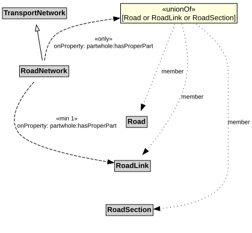

# RoadNetwork

A RoadNetwork is a type of TransportNetwork using a stabilized base designed for the movement of vehicles, other than rail or air vehicles, that conform to a specified set of requirements but may be used by others as well.

NOTE: Roads are most commonly associated with motor vehicles, but can be designed for other types of vehicles (e.g., micromobility vehicles).

## Restrictions

| Property | Restriction Type |
|----------|------------------|
| hasProperPart | All values from [Road](Road.md) or [RoadLink](RoadLink.md) or [RoadSection](RoadSection.md) |
| hasProperPart | Min cardinality 1 [RoadLink](RoadLink.md) |

## Pattern

This class is a part of the [RoadNetworkPattern](../RoadNetworkPattern.md) pattern.
