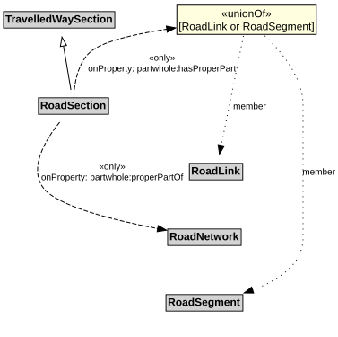

# RoadSection

A RoadSection is a type of TravelledWaySection that groups RoadLinks and RoadSegments for a useful operational purpose (e.g., assigning a speed limit, designating a traffic control scheme).

## Restrictions

| Property | Restriction Type |
|----------|------------------|
| hasProperPart | All values from [RoadLink](RoadLink.md) or [RoadSegment](RoadSegment.md) |
| properPartOf | All values from [RoadNetwork](RoadNetwork.md) |

## Pattern

This class is a part of the [RoadNetworkPattern](../RoadNetworkPattern.md) pattern.
