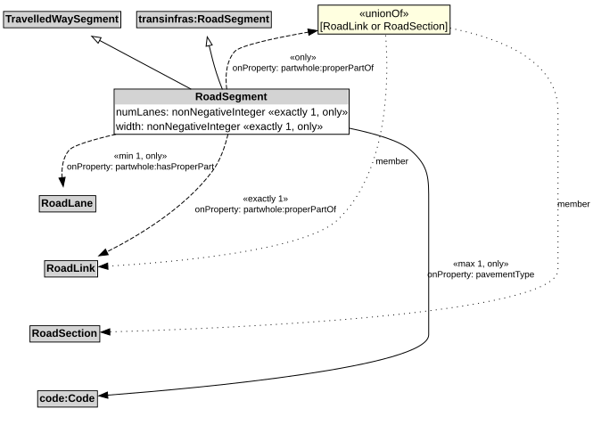

# RoadSegment

A RoadSegment is a type of TravelledWaySegment and transinfas:RoadSegment that represents a portion of a RoadLink with common physical characteristics.

NOTE: A RoadSegment can be defined to be a part of a RoadSection, for example, when the RoadSection does not span an entire RoadLink.

## Restrictions

| Property | Restriction Type |
|----------|------------------|
| hasProperPart | All values from [RoadLane](RoadLane.md) |
| hasProperPart | Min cardinality 1 [RoadLane](RoadLane.md) |
| numLanes | All values from xsd:nonNegativeInteger |
| numLanes | Exact cardinality 1 xsd:nonNegativeInteger |
| pavementType | All values from code:Code |
| pavementType | Max cardinality 1 code:Code |
| properPartOf | All values from [RoadLink](RoadLink.md) or [RoadSection](RoadSection.md) |
| properPartOf | Exact cardinality 1 [RoadLink](RoadLink.md) |
| width | All values from xsd:nonNegativeInteger |
| width | Exact cardinality 1 xsd:nonNegativeInteger |

## Pattern

This class is a part of the [RoadNetworkPattern](RoadNetworkPattern.md) pattern.
