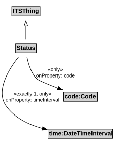

# Status

The operational status of an entity, e.g., open or closed.

## Restrictions

| Property | Restriction Type |
|----------|------------------|
| code | All values from code:Code |
| timeInterval | All values from time1:DateTimeInterval |
| timeInterval | Exact cardinality 1 time1:DateTimeInterval |

## Pattern

This class is a part of the [TransportNetworkPattern](../TransportNetworkPattern.md) pattern.
