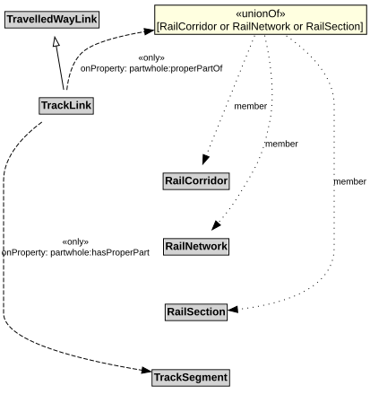

# TrackLink

A TrackLink is a type of TravelledWayLink that uses rails on a stabilized base.

NOTE: Due to the nature of rail, each TrackLink consists of a single lane, but multiple TrackLinks can exist along the same RailCorridor.

## Restrictions

| Property | Restriction Type |
|----------|------------------|
| hasProperPart | All values from [TrackSegment](TrackSegment.md) |
| properPartOf | All values from [RailCorridor](RailCorridor.md) or [RailNetwork](RailNetwork.md) or [RailSection](RailSection.md) |

## Pattern

This class is a part of the [RailNetworkPattern](RailNetworkPattern.md) pattern.
