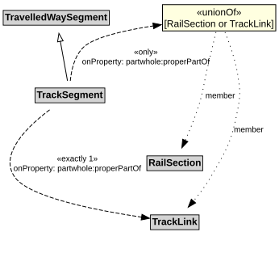

# TrackSegment

A TrackSegment is a type of TravelledWaySegment that represents a portion of a TrackLink with common physical characteristics.

## Restrictions

| Property | Restriction Type |
|----------|------------------|
| properPartOf | All values from [RailSection](RailSection.md) or [TrackLink](TrackLink.md) |
| properPartOf | Exact cardinality 1 [TrackLink](TrackLink.md) |

## Pattern

This class is a part of the [RailNetworkPattern](RailNetworkPattern.md) pattern.
