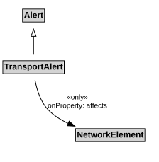

# TransportAlert

A TransportAlert is a type of alert that can be used to notify people of important transport information.

## Restrictions

| Property | Restriction Type |
|----------|------------------|
| affects | All values from [NetworkElement](NetworkElement.md) |

## Pattern

This class is a part of the [TransportAlertPattern](TransportAlertPattern.md) pattern.
