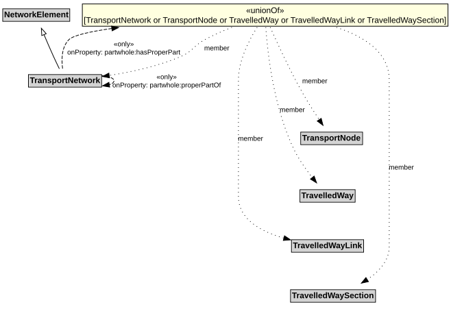

# TransportNetwork

A TransportNetwork is a NetworkElement that is a collection of other network elements that jointly represent a network of paths along which entities (e.g., vehicles, pedestrians) of a specified mode can operate.

## Restrictions

| Property | Restriction Type |
|----------|------------------|
| hasProperPart | All values from [TransportNetwork](TransportNetwork.md) or [TransportNode](TransportNode.md) or [TravelledWay](TravelledWay.md) or [TravelledWayLink](TravelledWayLink.md) or [TravelledWaySection](TravelledWaySection.md) |
| properPartOf | All values from [TransportNetwork](TransportNetwork.md) |

## Pattern

This class is a part of the [TransportNetworkPattern](TransportNetworkPattern.md) pattern.
