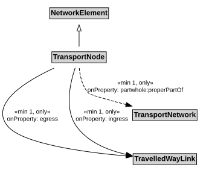

# TransportNode

A TransportNode is a NetworkElement that represents a node on the transport network that can be used to designate an end to a link or to join links.

## Restrictions

| Property | Restriction Type |
|----------|------------------|
| egress | All values from [TravelledWayLink](TravelledWayLink.md) |
| egress | Min cardinality 1 [TravelledWayLink](TravelledWayLink.md) |
| ingress | All values from [TravelledWayLink](TravelledWayLink.md) |
| ingress | Min cardinality 1 [TravelledWayLink](TravelledWayLink.md) |
| properPartOf | All values from [TransportNetwork](TransportNetwork.md) |
| properPartOf | Min cardinality 1 [TransportNetwork](TransportNetwork.md) |

## Pattern

This class is a part of the [TransportNetworkPattern](../TransportNetworkPattern.md) pattern.
