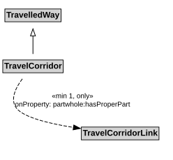

# TravelCorridor

A TravelCorridor is a type of TravelledWay that is made up of TravelCorridorLinks.

NOTE: The extent of a TravelCorridor is defined by the extent of the path that shares the designator assigned to the TravelCorridor.

## Restrictions

| Property | Restriction Type |
|----------|------------------|
| hasProperPart | All values from [TravelCorridorLink](TravelCorridorLink.md) |
| hasProperPart | Min cardinality 1 [TravelCorridorLink](TravelCorridorLink.md) |

## Pattern

This class is a part of the [TravelCorridorPattern](../TravelCorridorPattern.md) pattern.
