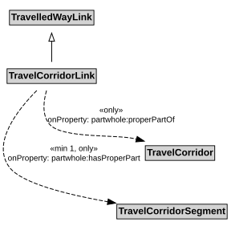

# TravelCorridorLink

A TravelCorridorLink is a type of TravelledWayLink that is made up of TravelCorridorSegments.

## Restrictions

| Property | Restriction Type |
|----------|------------------|
| hasProperPart | All values from [TravelCorridorSegment](TravelCorridorSegment.md) |
| hasProperPart | Min cardinality 1 [TravelCorridorSegment](TravelCorridorSegment.md) |
| properPartOf | All values from [TravelCorridor](TravelCorridor.md) |

## Pattern

This class is a part of the [TravelCorridorPattern](TravelCorridorPattern.md) pattern.
