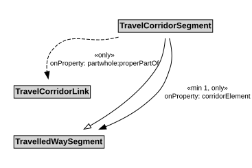

# TravelCorridorSegment

A TravelCorridorSegment is a type of TravelledWaySegment that logically groups multiple TravelledWaySegments together as being co-located or side-by-side.

## Restrictions

| Property | Restriction Type |
|----------|------------------|
| corridorElement | All values from [TravelledWaySegment](TravelledWaySegment.md) |
| corridorElement | Min cardinality 1 [TravelledWaySegment](TravelledWaySegment.md) |
| properPartOf | All values from [TravelCorridorLink](TravelCorridorLink.md) |

## Pattern

This class is a part of the [TravelCorridorPattern](TravelCorridorPattern.md) pattern.
