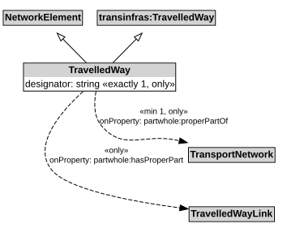

# TravelledWay

A TravelledWay is a type of NetworkElement and transinfras:TravelledWay that represents the curvilinear length of a transport route that is identified by a specific designator.

## Restrictions

| Property | Restriction Type |
|----------|------------------|
| designator | All values from xsd:string |
| designator | Exact cardinality 1 xsd:string |
| hasProperPart | All values from [TravelledWayLink](TravelledWayLink.md) |
| properPartOf | All values from [TransportNetwork](TransportNetwork.md) |
| properPartOf | Min cardinality 1 [TransportNetwork](TransportNetwork.md) |

## Pattern

This class is a part of the [TransportNetworkPattern](../TransportNetworkPattern.md) pattern.
