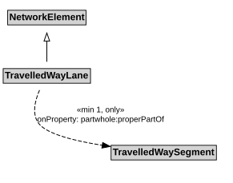

# TravelledWayLane

A TravelledWayLane is a NetworkElement that is a portion of TravelledWaySegment intended to accommodate a single line of moving material entities (e.g., vehicles) along its length.

## Restrictions

| Property | Restriction Type |
|----------|------------------|
| properPartOf | All values from [TravelledWaySegment](TravelledWaySegment.md) |
| properPartOf | Min cardinality 1 [TravelledWaySegment](TravelledWaySegment.md) |

## Pattern

This class is a part of the [TransportNetworkPattern](../TransportNetworkPattern.md) pattern.
