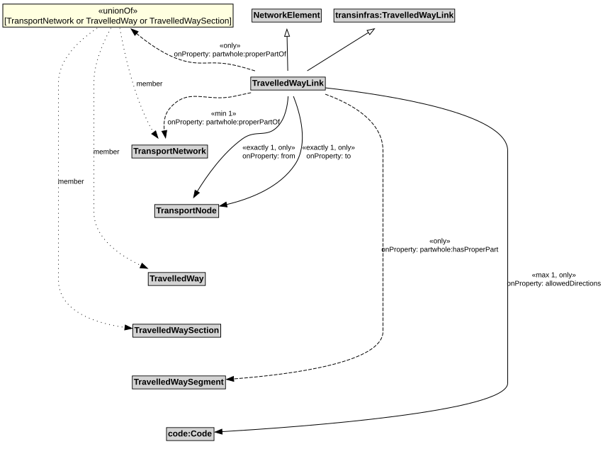

# TravelledWayLink

A TravelledWayLink is a type of NetworkElement and transinfras:TravelledWayLink. It represents a contiguous length of a TravelledWay between two TransportNodes of operational or managerial significance.

## Restrictions

| Property | Restriction Type |
|----------|------------------|
| allowedDirections | All values from code:Code |
| allowedDirections | Max cardinality 1 code:Code |
| from | All values from [TransportNode](TransportNode.md) |
| from | Exact cardinality 1 [TransportNode](TransportNode.md) |
| hasProperPart | All values from [TravelledWaySegment](TravelledWaySegment.md) |
| properPartOf | All values from [TransportNetwork](TransportNetwork.md) or [TravelledWay](TravelledWay.md) or [TravelledWaySection](TravelledWaySection.md) |
| properPartOf | Min cardinality 1 [TransportNetwork](TransportNetwork.md) |
| to | All values from [TransportNode](TransportNode.md) |
| to | Exact cardinality 1 [TransportNode](TransportNode.md) |

## Pattern

This class is a part of the [TransportNetworkPattern](../TransportNetworkPattern.md) pattern.
