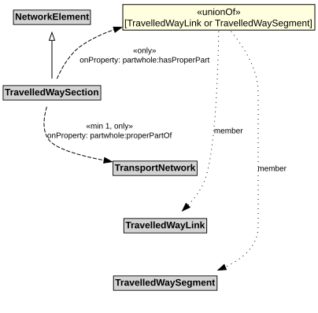

# TravelledWaySection

A TravelledWaySection is a type of NetworkElement that represents an aggregation of TravelledWayLinks and TravelledWaySegments that jointly represent a contiguous length of a path that shares the same management and operational strategies (within the scope of interest of the implementation).

## Restrictions

| Property | Restriction Type |
|----------|------------------|
| hasProperPart | All values from [TravelledWayLink](TravelledWayLink.md) or [TravelledWaySegment](TravelledWaySegment.md) |
| properPartOf | All values from [TransportNetwork](TransportNetwork.md) |
| properPartOf | Min cardinality 1 [TransportNetwork](TransportNetwork.md) |

## Pattern

This class is a part of the [TransportNetworkPattern](TransportNetworkPattern.md) pattern.
