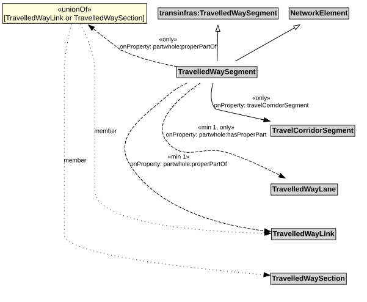

# TravelledWaySegment

A TravelledWaySegment is a type of a transinfras:TravelledWaySegment and NetworkElement that represents a contiguous length of a TravelledWayLink characterized by the same physical characteristics.

## Restrictions

| Property | Restriction Type |
|----------|------------------|
| hasProperPart | All values from [TravelledWayLane](TravelledWayLane.md) |
| hasProperPart | Min cardinality 1 [TravelledWayLane](TravelledWayLane.md) |
| properPartOf | All values from [TravelledWayLink](TravelledWayLink.md) or [TravelledWaySection](TravelledWaySection.md) |
| properPartOf | Min cardinality 1 [TravelledWayLink](TravelledWayLink.md) |
| travelCorridorSegment | All values from [TravelCorridorSegment](TravelCorridorSegment.md) |

## Pattern

This class is a part of the [TransportNetworkPattern](TransportNetworkPattern.md) pattern.
